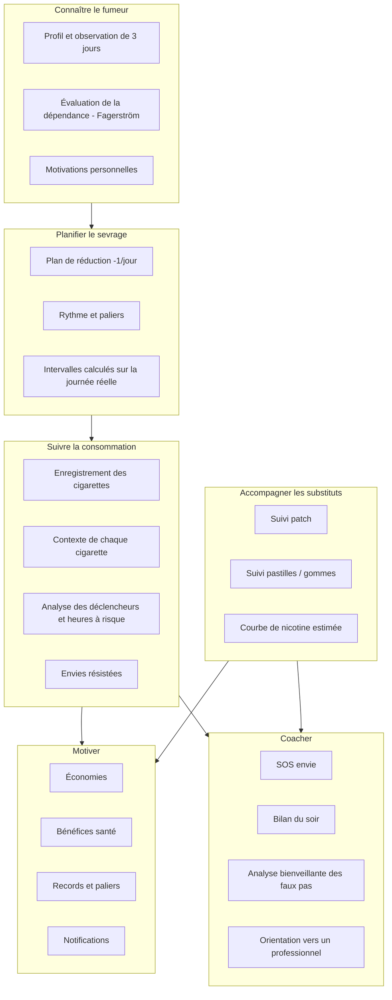
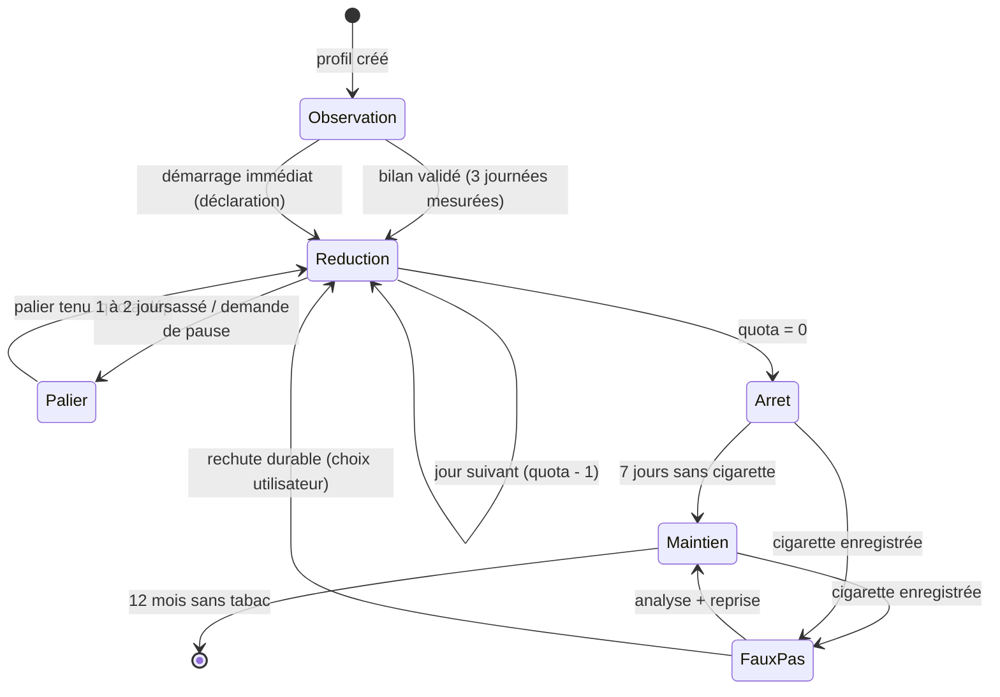
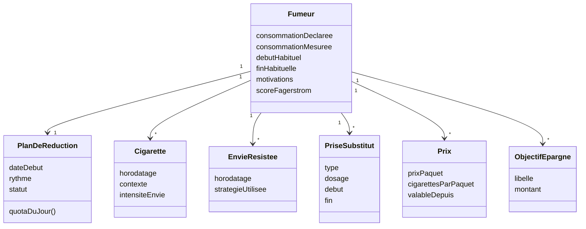

# 01 — Architecture métier

> Statut : **v0.1 — brouillon de cadrage** · Dernière mise à jour : 2026-10-23

## 1. Vision

**Déclic** accompagne un fumeur de *n* cigarettes par jour jusqu'à **zéro**, en retirant **une cigarette par jour** (rythme ajustable), avec :

- un **comptage** de chaque cigarette et de l'**intervalle** entre deux cigarettes ;
- un **suivi des substituts nicotiniques** (patchs, pastilles, gommes) et de leur durée d'effet estimée ;
- un **compteur d'économies** et de bénéfices santé ;
- un **coach IA** qui explique, motive et désamorce les envies — **sans jamais prescrire**.

Proposition de valeur : *« Une cigarette de moins chaque jour, un coach qui comprend tes moments. »*

## 2. Parties prenantes

| Acteur | Rôle | Attentes principales |
|---|---|---|
| **Fumeur / utilisateur** | Acteur principal | Réduire puis arrêter, sans culpabilisation, en voyant ses progrès |
| **Proche / buddy** (V2) | Soutien | Être tenu au courant, encourager au bon moment |
| **Tabacologue / pharmacien** | Caution scientifique | Valider la table pharmacologique et les contenus santé |
| **Médecin traitant** | Prescripteur des substituts | L'app *suit* la prescription, ne la remplace pas |
| **Tabac Info Service (39 89)** | Recours humain | Être proposé en cas de difficulté ou de détresse |
| **Éditeur (porteur du projet)** | Produit, conformité | Conformité RGPD / MDR / stores, soutenabilité économique |
| **Stores (Apple, Google)** | Distribution | Respect des règles « santé » et des allégations |
| **Fournisseur IA** | Sous-traitant | Contrat de traitement des données (DPA), pas d'entraînement sur les données |

## 3. Carte des capacités métier

## 4. Processus métier : le parcours de sevrage

| Phase | Objectif | Indicateur de sortie |
|---|---|---|
| Observation | Mesurer la vraie consommation, les horaires et les déclencheurs (l'utilisateur fume normalement et note tout) | 3 journées complètes mesurées, bilan validé |
| Réduction | Retirer 1 cigarette par jour (rythme configurable) | Quota du jour = 0 |
| Palier | Consolider sans reculer | 1 à 2 jours au quota tenu |
| Arrêt | Premiers jours sans tabac, souvent sous substituts | 7 jours consécutifs |
| Maintien | Prévenir la rechute, réduire les substituts | 12 mois |
| Faux pas | Comprendre, sans remise à zéro punitive | Reprise du plan |

## 5. Règles métier

| ID | Règle |
|---|---|
| RM-01 | **Quota du jour** : `quota(j) = max(0, q₀ − pas × ⌊j / période⌋)`, avec `q₀ = référence − 1` ; rythme par défaut : pas = 1, période = 1 jour. |
| RM-02 | **Intervalle cible** : `durée active habituelle ÷ (quota(j) − 1)`, la durée active étant l'écart habituel entre la première et la dernière cigarette de la journée (RM-17). Sous 2 cigarettes, pas d'intervalle ; quota = 0 : mode arrêt. |
| RM-03 | **Prochaine cigarette conseillée** : la première de la journée n'a **pas d'heure imposée** (c'est elle qui ouvre la journée) ; ensuite `dernière cigarette + intervalle cible`. |
| RM-04 | **Dépassement de quota** : le plan **ne recule pas** automatiquement ; le lendemain, le coach propose un **palier** (même quota) au lieu de baisser. |
| RM-05 | **Faux pas après l'arrêt** : il est enregistré et analysé ; les compteurs « depuis la dernière cigarette » repartent, mais les **économies cumulées et les records sont conservés**. |
| RM-06 | **Prix d'une cigarette** : `prix du paquet ÷ cigarettes par paquet`, versionné dans le temps (un changement de prix ne réécrit pas le passé). |
| RM-07 | **Économie du jour** : `(référence − cigarettes fumées ce jour) × prix unitaire du jour`, jamais négative. La référence est la consommation **mesurée** pendant l'observation (ou déclarée en cas de démarrage immédiat). La journée en cours est comptée au prorata de la durée active écoulée. |
| RM-08 | **Substituts** : l'app **enregistre** la prescription ou l'usage déclaré et applique les **limites de la notice** de la table de référence ; elle **ne calcule ni ne modifie** un dosage. |
| RM-09 | **Maximum de prises** : atteindre le maximum journalier de la notice déclenche une information et une orientation vers un pharmacien. |
| RM-10 | **Coach IA** : il n'émet aucun conseil de dosage ni de diagnostic ; tout symptôme ou signe de détresse déclenche une **orientation** vers le 39 89, le médecin ou le 15/112. |
| RM-11 | **Ton** : aucun message culpabilisant ; le vocabulaire est « faux pas », jamais « échec ». |
| RM-12 | **Notifications** : au plus 4 notifications non critiques par jour, aucune pendant les heures calmes. |
| RM-13 | **Premier jour partiel** : si le plan démarre dans une journée **déjà entamée** (démarrage immédiat), seules les cigarettes fumées après le démarrage comptent ; le quota du jour est réduit à la part restante de la durée active (arrondi au supérieur) et les économies partent du démarrage. L'intervalle reste celui du plan. |
| RM-14 | **Journée de fumeur** : on ne demande pas les heures de lever et de coucher. Une journée commence à la **première cigarette qui suit une pause d'au moins 5 h** (la nuit) et porte la date locale de cette cigarette ; les cigarettes fumées après minuit avant de dormir restent sur la veille. Deux morceaux séparés par une longue pause le même jour civil gardent la même date. Les envies et les substituts suivent la journée de la dernière cigarette (moins de 5 h), sinon la date du jour. |
| RM-15 | **Observation** : à la création du profil, l'utilisateur fume normalement pendant **3 journées complètes** en notant chaque cigarette. La journée d'installation ne compte pas s'il a déjà fumé avant d'installer l'app. À l'issue, l'app présente un bilan (consommation, horaires, intervalle, déclencheurs) et propose le plan, qui démarre la journée suivante si la journée en cours est entamée. Un démarrage immédiat sur la consommation déclarée reste possible. |
| RM-16 | **Contexte** : après chaque « J'ai fumé », l'app propose en un tap le contexte (café, stress, après le repas, alcool, pause au travail, avec d'autres fumeurs, ennui, puis les contextes ajoutés par l'utilisateur) ; « + Ajouter un contexte » permet d'en saisir un nouveau (1 à 30 caractères), aussitôt attribué à la cigarette et proposé ensuite comme les autres — un libellé déjà existant est réutilisé et l'heure réelle si la saisie est tardive (« il y a 10 min / 30 min / 1 h ») ; « Passer » est toujours possible. Les contextes alimentent l'analyse des déclencheurs et des heures à risque (14 derniers jours). |
| RM-17 | **Habitudes** : calculées sur les journées **terminées** uniquement (7 dernières) : médiane de l'heure de la première et de la dernière cigarette, médiane de la durée active, moyenne des cigarettes par journée, intervalle moyen entre deux cigarettes d'une même journée (nuits exclues). Les habitudes de l'observation sont figées au démarrage du plan. |
| RM-18 | **Respect de l'intervalle** : chaque cigarette de la journée, sauf la première, est comparée à la précédente. Écart ≥ intervalle recommandé (60 min pendant l'observation, intervalle cible pendant le plan), à 1 min près : **intervalle tenu** (affiché en vert) ; sinon **trop tôt** (affiché en rouge). Le compteur est informatif, jamais culpabilisant (RM-11). |
| RM-19 | **Descente par paliers libres** (méthode de l'utilisateur) : après l'observation (apport réel, contextes), on descend par **paliers choisis** (taille libre, −x) jusqu'à trouver la **limite** où ça devient difficile, en remplaçant chaque contexte par une nouvelle habitude ; un palier s'applique dès le jour même et ne peut **jamais remonter** au-dessus du palier en cours ; en paliers libres, le quota ne baisse pas automatiquement. Une fois la limite trouvée et stabilisée, on passe au rythme « −1 » (par jour, tous les 2 jours ou par semaine). |
| RM-20 | **Patch par journée** : chaque journée indique « avec » ou « sans » patch, le dosage, l'heure de pose et l'heure de renouvellement prévue (pose + durée de port, en temps réel, changement d'heure compris) et, s'il est connu, l'heure de retrait. |
| RM-21 | **Observation réglable** : de 1 à 7 journées complètes mesurées (3 par défaut) avant de proposer le premier palier. |
| RM-22 | **Contextes et parades** : pour chaque contexte, l'utilisateur choisit une parade (nouveau réflexe, 60 caractères). « J'ai résisté » demande le contexte. Sur 7 jours, chaque contexte affiche ses cigarettes, ses envies résistées et une tendance calculée sur les journées terminées (2 dernières contre les précédentes) : à observer, nouveau, persiste, en baisse (≤ 75 %), disparu. |
| RM-23 | **Suivi biologique** : bilans saisis (date, valeurs) ou importés ; courbe et évolution par paramètre ; non-HDL calculé ; statut par rapport à la norme (usuelle, du laboratoire ou objectif du médecin saisi par l'utilisateur) : dans la norme, à surveiller (à moins de 15 % d'une limite ou seuil propre : B12 < 300 pg/mL, HbA1c ≥ 5,7 %), trop haut, trop bas. Aucun objectif ni traitement proposé. Les bilans restent sur le téléphone et ne sont jamais envoyés au coach IA. |
| RM-24 | **Aliments selon toutes les anomalies** : chaque aliment a un effet établi (+ aide, − aggrave) par objectif (LDL, HDL, triglycérides, B12, glycémie, inflammation ; sources ESC/EAS 2019, ANSES). Règle stricte : à éliminer dès qu'il aggrave UN objectif actif ; à privilégier s'il en aide au moins un sans en aggraver aucun ; neutre sinon. |
| RM-25 | **Caféine** : boissons caféinées notées (café 80 mg, thé 40, cola 35, énergisante 80, déca 3, teneurs moyennes indicatives), total du jour en mg face au repère adulte de 400 mg (EFSA 2015). Palier de boissons caféinées par jour (déca non compté) : on ne peut que descendre, jamais au-dessus du palier précédent. Lien avec le tabac : boissons suivies d'une cigarette dans les 20 minutes. |
| RM-26 | **Statistiques** : sur les journées notées seulement (une journée sans saisie n'est pas un zéro), 14 derniers jours : cigarettes par jour et par semaine, tendance (3 dernières journées terminées contre les 3 précédentes, seuil ±10 %), répartition par heure, semaine / week-end, première et dernière cigarette, moyenne du jour hors nuit, nuit, plus longue pause d'éveil, contextes (semaine d'avant / cette semaine), envies résistées, techniques du SOS, effet des parades (cigarettes par jour dans le contexte avant / depuis la parade), café → cigarette, cigarettes par jour dans les 7 jours précédant chaque bilan. |

## 6. Objets métier

## 7. Indicateurs (KPI)

| Indicateur | Définition | Usage |
|---|---|---|
| Taux de respect du quota | jours avec cigarettes ≤ quota ÷ jours du plan | Qualité du plan, ajustement du rythme |
| Intervalle moyen réel / cible | moyenne glissante sur 3 jours | Signal de difficulté |
| Envies résistées | nombre par jour, stratégie qui fonctionne | Personnalisation du coach |
| Jours sans tabac | depuis la dernière cigarette | Motivation, phases |
| Économies cumulées | somme RM-07 | Motivation |
| Rétention J7 / J30 | utilisateurs actifs | Produit |
| Abstinence déclarée à 3 et 6 mois | questionnaire in-app | Efficacité (à valider avec un protocole sérieux) |

## 8. Contraintes réglementaires et éthiques

| Domaine | Contrainte | Conséquence d'architecture |
|---|---|---|
| **RGPD — données de santé** (art. 9) | Consentement explicite, minimisation, droits d'accès et d'effacement | Local-first, export et suppression en un clic, analyse d'impact (AIPD) |
| **HDS** (hébergement de données de santé, France) | Certification obligatoire si l'éditeur héberge des données de santé identifiantes | Pas de stockage serveur au MVP ; le coach ne reçoit qu'un résumé **non identifiant** |
| **Règlement dispositifs médicaux (MDR 2017/745)** | Un logiciel qui calcule une dose ou pose un diagnostic peut être un dispositif médical | RM-08 et RM-10 : suivi et information, **pas de prescription** ; position à valider juridiquement |
| **Loi Évin** | Pas de publicité ni de valorisation du tabac | Aucune marque de cigarettes, aucun visuel valorisant |
| **Règles des stores** | Allégations santé encadrées, sources requises | Contenus sourcés, mentions « ne remplace pas un avis médical » |
| **AI Act (UE)** | Transparence : l'utilisateur sait qu'il parle à une IA | Mention explicite dans le coach |
