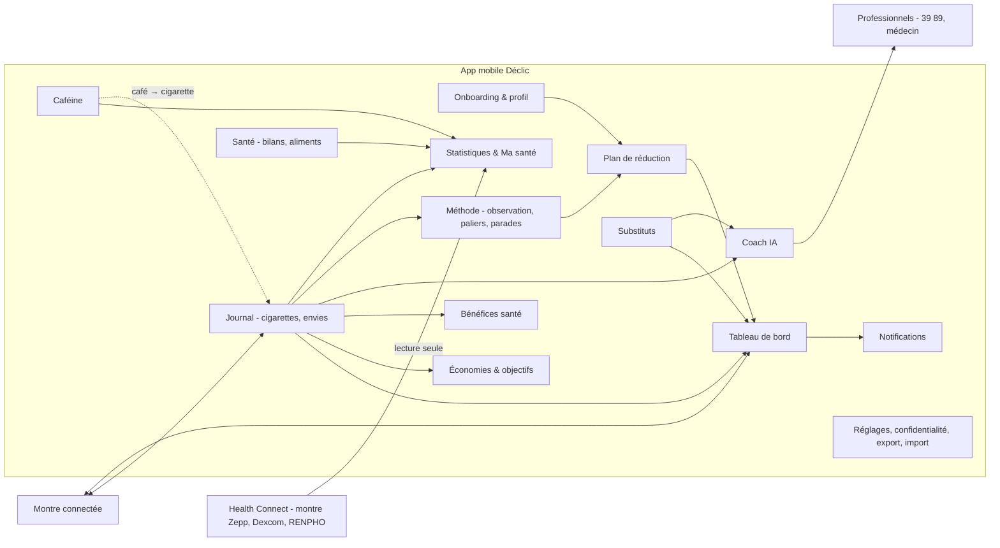
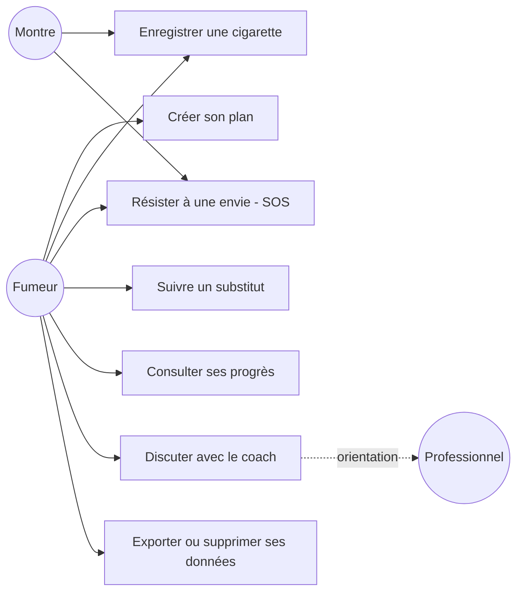
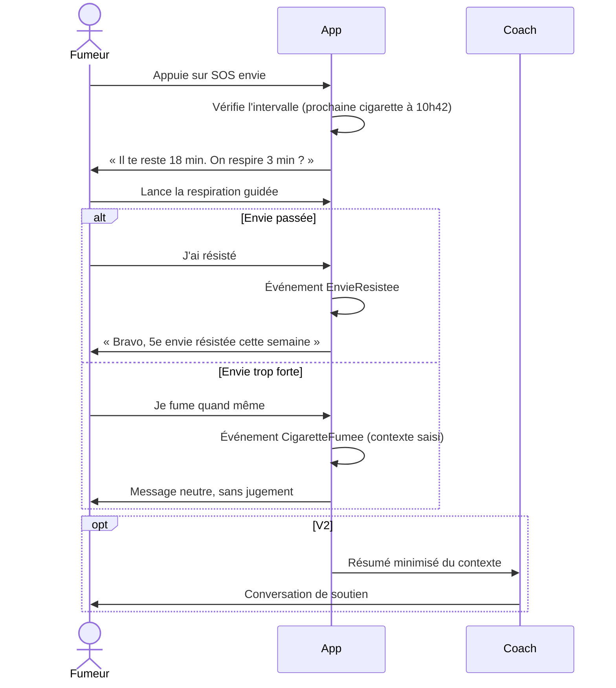

# 02 — Architecture fonctionnelle

> Statut : **v0.2 — aligné sur le code** · Dernière mise à jour : 2026-10-28 (F10 à F14 ajoutés, F5, F7, F8 mis à jour)

## 1. Domaines fonctionnels

## 2. Catalogue des fonctions

Priorités : **MVP** = première version publiable ; **V2** = coach IA et montre ; **V3** = capteurs et social.

### F1 — Onboarding et profil

| ID | Fonction | Priorité |
|---|---|---|
| F1.1 | Saisir une estimation de la consommation, le prix du paquet, le nombre de cigarettes par paquet et « j'ai déjà fumé aujourd'hui » | MVP |
| F1.2 | **Observation de 3 journées** (RM-15) : progression, puis bilan (consommation mesurée, première et dernière cigarette habituelles, intervalle moyen, déclencheurs) et bouton « Démarrer mon plan » ; démarrage immédiat possible | MVP |
| F1.3 | Test de dépendance (Fagerström, 6 questions) | MVP |
| F1.4 | Saisir ses motivations (texte libre, réutilisé par le SOS envie) | MVP |
| F1.5 | Choisir le rythme : −1/jour, −1/2 jours, −1/semaine | MVP |
| F1.6 | Consentements RGPD granulaires (données de santé, notifications, coach IA, données de la montre) | MVP |

### F2 — Plan de réduction

| ID | Fonction | Priorité |
|---|---|---|
| F2.1 | Calculer le quota du jour (RM-01) | MVP |
| F2.2 | Calculer l'intervalle cible et la prochaine cigarette conseillée (RM-02, RM-03) | MVP |
| F2.3 | Proposer un palier en cas de dépassement (RM-04) | MVP |
| F2.4 | Visualiser le plan complet (courbe jusqu'à zéro) | MVP |
| F2.5 | Modifier le rythme en cours de route (Réglages ; effet le lendemain) | MVP |
| F2.6 | Réglages : prix du paquet (à partir du jour même, RM-06), intervalle recommandé d'observation (30 min à 2 h), contextes personnels (renommer, retirer), démarrage du plan | MVP |

### F3 — Journal

| ID | Fonction | Priorité |
|---|---|---|
| F3.1 | Bouton « J'ai fumé » : horodatage automatique, correction possible | MVP |
| F3.2 | Contexte proposé en un tap après chaque cigarette (RM-16), avec « Passer » ; « + Ajouter un contexte » ouvre un champ de saisie, le nouveau contexte rejoint la liste | MVP |
| F3.6 | Correction de l'heure d'une saisie tardive (« il y a 10 min / 30 min / 1 h ») | MVP |
| F3.3 | Bouton « J'ai résisté » : enregistrer une envie surmontée et la stratégie utilisée | MVP |
| F3.4 | Historique : graphique des 14 derniers jours (fumées / quota), détail par journée (heure, contexte, intervalle tenu ou non), changer le contexte ou supprimer une cigarette passée | MVP |
| F3.5 | Analyse des déclencheurs (top 3, en %) et des heures à risque sur 14 jours | MVP |

### F4 — Substituts nicotiniques

| ID | Fonction | Priorité |
|---|---|---|
| F4.1 | Déclarer un traitement : type, dosage, source (prescription ou automédication) | MVP |
| F4.2 | Patch : heure de pose, durée de port (16 h ou 24 h), rappel de retrait ou de changement, rotation du site | MVP |
| F4.3 | Pastille ou gomme : enregistrer une prise, compteur journalier, maximum de la notice (RM-09) | MVP |
| F4.4 | Courbe de nicotine **estimée** (indicative), issue de la table de référence | V2 |
| F4.5 | Signal « compensation » : pastilles en hausse pendant que les cigarettes baissent → information et orientation | V2 |

### F5 — Tableau de bord, économies, santé

| ID | Fonction | Priorité |
|---|---|---|
| F5.1 | **Compteur unique** en haut de l'écran : « −mm:ss » (orange) jusqu'à la prochaine cigarette conseillée, puis « +mm:ss » (vert) au-delà de l'objectif, remis à zéro par « J'ai fumé » ; dessous, **moyenne du jour en direct** (hors nuit, ne baisse jamais pendant qu'on tient). Pendant l'observation, objectif **indicatif** (60 min par défaut), sans notification | MVP |
| F5.7 | Écran principal : compteur, **6 chiffres essentiels** (fumées / quota, intervalle tenu, trop tôt — neutre pendant l'observation —, envies résistées, depuis la dernière ou économies, cafés ; patch quand il est porté), « Plus de chiffres » (plus longue pause d'éveil, nuit sans fumer, moyenne 7 jours, recommandé, déclencheur, heure à risque), actions (J'ai fumé, SOS envie, J'ai résisté, ☕) et **barre d'onglets** (Accueil, Historique, Progrès, Santé, Réglages) | MVP |
| F5.2 | Quota du jour ; intervalle cible ; intervalle moyen réel aujourd'hui et sur 7 jours (nuits exclues) ; plus longue pause | MVP |
| F5.3 | Économies du jour, cumulées, projetées sur 1 mois et 1 an (RM-06, RM-07) | MVP |
| F5.4 | Objectifs d'épargne (« mon vélo à 400 € ») avec date estimée | MVP |
| F5.5 | Bénéfices santé débloqués dans le temps (contenus sourcés) | MVP |
| F5.6 | Records : plus long intervalle, jours sans tabac | MVP |
| F5.8 | Historique : graphe jour / semaine / mois, écart entre deux cigarettes en dégradé (rouge = le plus court du jour, vert = le plus long), moyenne du jour et nuit précédente, cigarettes avec ou sans patch, correction de l'heure et du contexte | MVP |

### F6 — Notifications

| ID | Type | Exemple | Priorité |
|---|---|---|---|
| F6.1 | Actionnable « J'ai fumé / J'ai résisté » | depuis la notification ou la montre | MVP |
| F6.2 | Prochaine cigarette possible | « Tu peux, ou tu tentes 10 min de plus ? » | MVP |
| F6.3 | Paliers d'économies | « 50 € économisés ! » | MVP |
| F6.4 | Bénéfices santé | « 48 h : le goût revient. » | MVP |
| F6.5 | Progression du plan | « Nouveau palier : 14 aujourd'hui. » | MVP |
| F6.6 | Rappels de substituts | « Retire ton patch » | MVP |
| F6.7 | Bilan hebdomadaire | cigarettes évitées, économies | MVP |
| F6.8 | Préventive (heure à risque) | « C'est souvent ta pause clope. » | V2 |
| F6.9 | Bilan du soir par le coach IA | message personnalisé | V2 |

Règles transverses : plafond de 4 notifications non critiques par jour, heures calmes, priorités (rappel de substitut > plan > célébration), regroupement des célébrations, réglage par catégorie (RM-12).

### F7 — Coach IA

| ID | Fonction | Priorité |
|---|---|---|
| F7.1 | SOS envie **scripté** (hors ligne) : 4 respirations guidées au choix (cohérence cardiaque, soupir cyclique, expiration longue, carrée), rappel des raisons d'arrêter et des économies, « L'envie est passée » = envie résistée, fermeture = envie signalée ; bilan « ce qui marche pour toi » par technique | MVP |
| F7.2 | SOS envie **conversationnel** (IA) | V2 |
| F7.3 | Bilan du soir et ajustement proposé | V2 |
| F7.4 | Analyse bienveillante d'un faux pas | V2 |
| F7.5 | Garde-fous : refus de dosage, détection de détresse → 39 89 / 15 / 112 (RM-10) | V2 |
| F7.6 | Mention « tu parles à une IA » et lien vers un humain | V2 |

### F8 — Montre connectée

| ID | Fonction | Priorité |
|---|---|---|
| F8.1 | Notifications actionnables relayées par le téléphone | MVP |
| F8.2 | Mini-app : boutons « J'ai fumé » et « SOS », respiration par vibrations | V2 |
| F8.3 | Complication du cadran : prochaine cigarette, quota restant | V2 |
| F8.4 | Lecture du stress (fréquence cardiaque, variabilité) via HealthKit / Health Connect | ✅ fait via F12 (Android) |
| F8.5 | Détection du geste de fumer (ML, accéléromètre) | V3 (R&D) |

### F9 — Réglages et confidentialité

| ID | Fonction | Priorité |
|---|---|---|
| F9.1 | Export complet des données : JSON partagé via la feuille de partage du téléphone (chiffrement de l'export : à faire) | MVP |
| F9.2 | Suppression totale en un geste | MVP |
| F9.3 | Verrouillage de l'app (Face ID, empreinte) | MVP |
| F9.4 | Gestion des consentements | MVP |
| F9.5 | Restauration depuis un export | MVP |
| F9.6 | Sauvegarde vers un fichier (Drive, Téléchargements) et restauration vérifiée avant effacement | MVP |
| F9.7 | Import d'un historique tenu à part (aperçu, simulation, rapprochement manuel, idempotent ; ADR-0010) | MVP |

### F10 — Santé : bilans et aliments

| ID | Fonction | Priorité |
|---|---|---|
| F10.1 | Saisie ou import de bilans biologiques ; courbe et évolution par paramètre ; non-HDL calculé (RM-23) | MVP |
| F10.2 | Statut : dans la norme, à surveiller, trop haut, trop bas ; norme du labo ou objectif du médecin modifiable | MVP |
| F10.3 | Aliments classés selon **toutes** les anomalies actives : à privilégier, à éliminer (avec la raison), neutres (RM-24) | MVP |

### F11 — Caféine

| ID | Fonction | Priorité |
|---|---|---|
| F11.1 | ☕ en un tap ; boissons et mg du jour face au repère de 400 mg (RM-25) | MVP |
| F11.2 | Palier de boissons caféinées qui ne remonte jamais ; cafés suivis d'une cigarette dans les 20 min | MVP |

### F12 — Montre et capteurs (Health Connect, lecture seule)

| ID | Fonction | Priorité |
|---|---|---|
| F12.1 | Lecture à la demande (4 semaines) : sommeil et phases, fréquence cardiaque, repos, HRV, pas (dédoublonnés), SpO2, glycémie, tension, poids (RM-27, ADR-0011) | MVP |
| F12.2 | Délai réveil → première cigarette ; cœur 30 min avant / après une cigarette | MVP |
| F12.3 | Sommeil réparateur par semaine (vert / orange / rouge) et pistes tirées des nuits (RM-28) | MVP |

### F13 — Statistiques et Ma santé

| ID | Fonction | Priorité |
|---|---|---|
| F13.1 | Statistiques en 14 rubriques sur les journées notées (RM-26) | MVP |
| F13.2 | Ma santé : une case par axe, semaine comparée à la précédente, verdict vert / orange / rouge, tap = détail (RM-29) | MVP |

### F14 — Méthode

| ID | Fonction | Priorité |
|---|---|---|
| F14.1 | Observation réglable de 1 à 7 journées (RM-21), bilan d'observation (par jour, première heure, avant midi, palier proposé) | MVP |
| F14.2 | Paliers libres, jamais au-dessus du palier précédent (RM-19), puis rythmes −1 | MVP |
| F14.3 | Contextes et parades : tendance par contexte sur 7 jours, effet mesuré d'une parade (RM-22) | MVP |
| F14.4 | Parcours guidé « Où j'en suis » (étape actuelle, prochaine action) | à faire |

## 3. Cas d'utilisation

## 4. Parcours clé : « J'ai envie »

## 5. Exigences non fonctionnelles

| ID | Exigence | Cible |
|---|---|---|
| ENF-01 | Enregistrer une cigarette en un tap | moins de 1 s, hors ligne |
| ENF-02 | Fonctionnement hors ligne | 100 % des fonctions MVP |
| ENF-03 | Exactitude des calculs | 100 % de couverture de tests du domaine |
| ENF-04 | Confidentialité | aucune donnée de santé identifiante hors du téléphone |
| ENF-05 | Accessibilité | RGAA / WCAG 2.2 AA, tailles de police dynamiques |
| ENF-06 | Langues | français au MVP, anglais en V2 |
| ENF-07 | Plateformes | iOS 16+ et Android 10+ (à confirmer selon la version d'Expo) |
| ENF-08 | Démarrage à froid | moins de 2 s sur un téléphone milieu de gamme |
| ENF-09 | Latence du coach IA | premier mot en moins de 2 s (streaming) |
