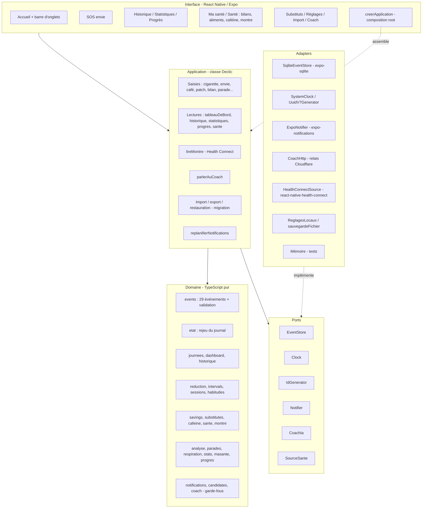
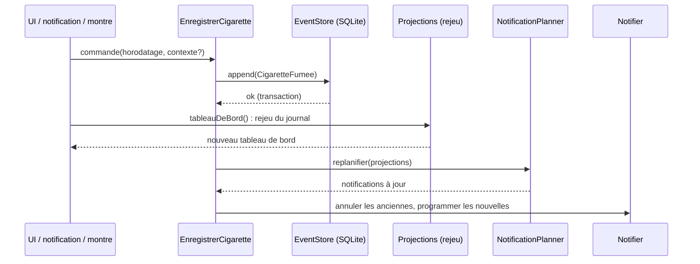
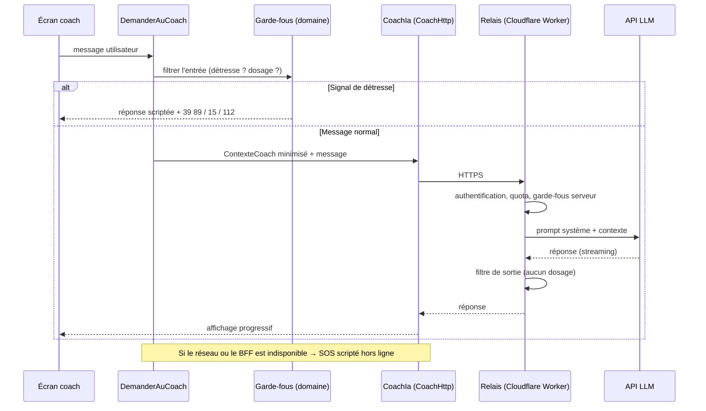
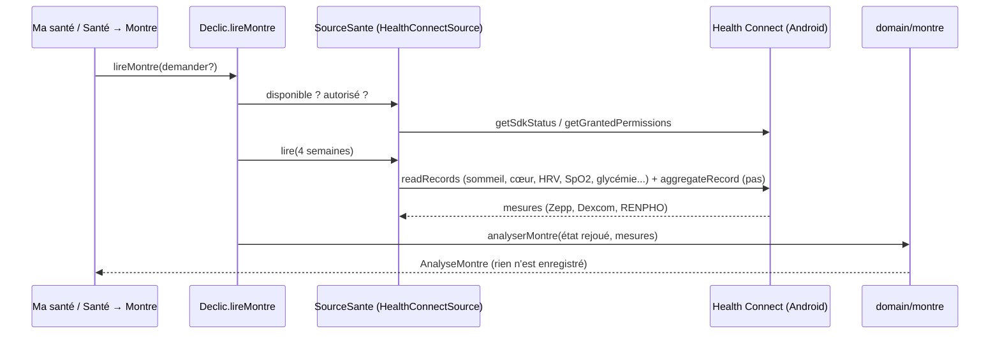
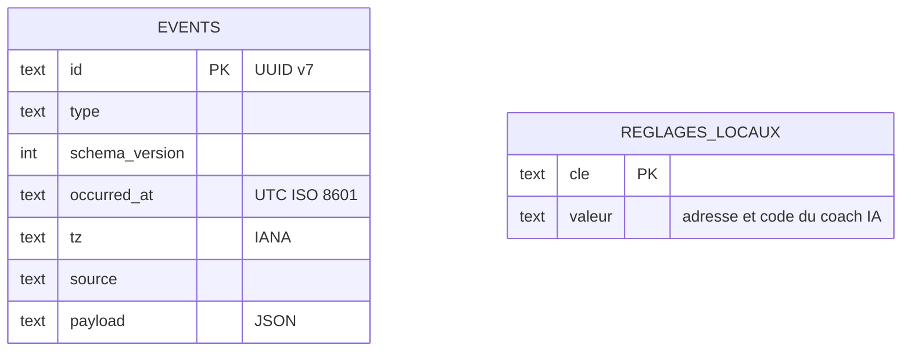

# 03 — Architecture applicative

> Statut : **v0.2 — aligné sur le code** · Dernière mise à jour : 2026-10-28 (ports, modules, 29 événements, contextes, Health Connect)

## 1. Principes

| Principe | Application dans Déclic |
|---|---|
| **Hexagonale (ports & adapters)** | Le domaine est du TypeScript pur, sans dépendance à React, à la base ou à l'horloge système |
| **Event sourcing local** | La source de vérité est un journal d'événements immuables, stocké sur le téléphone |
| **CQRS léger** | Écriture = ajout d'un événement ; lecture = projections **recalculées à la demande** en rejouant le journal (aucune projection stockée) |
| **Local-first** | Tout fonctionne hors ligne ; le réseau n'est requis que pour le coach IA et les mises à jour ; Health Connect est local au téléphone |
| **Configuration par les données** | Les paramètres pharmacologiques et les contenus santé sont dans une table de référence versionnée |
| **Le LLM explique, le code calcule** | Aucun calcul métier n'est confié au modèle de langage |

Les décisions correspondantes sont tracées dans les [ADR](adr/).

## 2. Vue en couches



Règle de dépendance : **les flèches pointent vers le domaine**. Le domaine n'importe ni React, ni Expo, ni un adapter (vérifié). Seule la composition root (`ui/app/creerApplication.ts`) connaît les adapters ; exception acceptée : `ui/app/donnees.ts` appelle directement le sélecteur de fichier (action d'interface, sans règle métier).

Données de référence : JSON embarqués (`config/pharma-reference.json`, `config/health-milestones.json`) passés au constructeur de `Declic`, et non un port.

## 3. Contextes métier et modules

Un **seul journal** et un **seul rejeu** (`etat.ts`) alimentent plusieurs contextes ; chaque contexte a ses projections.

| Contexte | Événements | Modules du domaine | Projections |
|---|---|---|---|
| Tabac — journal et plan | `ProfilCree`, `PlanDemarre`, `RythmeModifie`, `PalierDemande`, `PalierFixe`, `ObservationReglee`, `StabilisationDemarree`, `CigaretteFumee`, `CigaretteCorrigee`, `AgregatSansHeure`, `SaisieAnnulee`, `IntervalleRecommandeModifie` | `etat`, `journees`, `sessions`, `habitudes`, `reduction`, `intervals` | tableau de bord, historique, observation |
| Envies et contextes | `EnvieResistee`, `EnvieSignalee`, `ContexteAjoute`, `ContexteRenomme`, `ContexteArchive`, `ParadeDefinie`, `RaisonAjoutee` | `analyse`, `parades`, `respiration` | déclencheurs, parades et tendance, techniques du SOS |
| Substituts | `PatchPose`, `PatchRetire`, `SubstitutOralPris` | `substitutes` | patch en cours, prises du jour, cigarettes avec / sans patch |
| Économies | `PrixModifie`, `ObjectifEpargneDefini`, `ObjectifRetire` | `savings`, `progres` | économies, objectifs, records |
| Caféine | `BoissonPrise`, `PalierCafeine` | `cafeine` | suivi 7 jours, café → cigarette |
| Santé biologique | `BilanSaisi`, `NormeDefinie` | `sante` | suivi par paramètre, objectifs actifs, aliments classés |
| Montre et capteurs | *(aucun : lecture Health Connect à la demande)* | `montre` | sommeil, réparateur par semaine, cœur, pistes |
| Transverses | `ConsentementModifie` | `stats`, `masante`, `notifications`, `candidates`, `coach` | statistiques, Ma santé, notifications, résumé du coach |

| Module | Responsabilité |
|---|---|
| `domain/events` | Types des 29 événements, provenance (import), validation |
| `domain/etat` | **Rejeu** du journal : état courant de tous les contextes (`EtatJournal`) |
| `domain/journees` | Observation (RM-15, RM-21), proposition de plan, quotas effectifs, éléments d'une journée |
| `domain/dashboard` | Projection du tableau de bord ; **façade** qui réexporte `etat`, `journees`, `historique` |
| `domain/historique` | Historique détaillé par journée (écarts, nuit, patch) |
| `domain/sessions` | Journées de fumeur (RM-14), intervalles hors nuit, nuits, moyenne en direct |
| `domain/habitudes` | Habitudes mesurées (RM-17) |
| `domain/analyse` | Déclencheurs et heures à risque (RM-16) |
| `domain/reduction` | Stratégies `ReductionStrategy` (−1, paliers libres) et quotas |
| `domain/intervals` | Intervalle cible, prochaine cigarette, respect (RM-18) |
| `domain/savings` | Économies, projections, objectifs |
| `domain/substitutes` | Patch, pastilles, gommes, limites de la notice |
| `domain/cafeine` | Caféine (RM-25) |
| `domain/sante` | Bilans, statuts, aliments selon toutes les anomalies (RM-23, RM-24) |
| `domain/montre` | Croisement Health Connect × journal, sommeil réparateur, pistes (RM-27, RM-28) |
| `domain/parades` | Contextes, parades, tendance (RM-22) |
| `domain/respiration` | Techniques du SOS et leur bilan |
| `domain/stats`, `domain/masante`, `domain/progres` | Statistiques (RM-26), Ma santé (RM-29), records et bilan de la semaine |
| `domain/notifications`, `domain/candidates` | Planificateur et candidats de notifications (RM-12) |
| `domain/coach` | Messages scriptés, garde-fous, résumé minimisé |
| `application/declic` | Cas d'usage (classe `Declic`) |
| `application/migration` | Anti-corruption de l'import : formats v1 / v2 / source, aperçu, simulation, rapprochement (ADR-0010) |

## 4. Événements du domaine

29 types. Chaque événement porte : `id` (UUID v7), `type`, `schemaVersion` (1 pour tous : les évolutions sont des champs **optionnels ajoutés**, rétrocompatibles), `occurredAt` (UTC), `tz` (IANA), `source` (`phone`, `notification`, `watch`, `import`), `payload`.

| Événement | Charge utile principale |
|---|---|
| `ProfilCree` | consommation déclarée, prix, cigarettes par paquet, « déjà fumé aujourd'hui » |
| `StabilisationDemarree` | date (passage à l'étape 3 « Stabiliser », RM-32) |
| `PlanDemarre` | date, stratégie, référence, quota de départ, horaires, origine, `journeeEntiere ?` (maximum imposé en cours de journée, RM-30) |
| `RythmeModifie` | date d'effet, stratégie |
| `PalierDemande` | jour (garder le quota) |
| `PalierFixe` | date d'effet, quota (jamais au-dessus du quota courant, RM-19) |
| `ObservationReglee` | journées d'observation (1 à 7) |
| `CigaretteFumee` | contexte ?, intensité ?, provenance (précision, journée, origine, note) |
| `CigaretteCorrigee` | id, contexte ?, heure réelle ? |
| `AgregatSansHeure` | journée, nature (cigarettes / envies), nombre (import) |
| `SaisieAnnulee` | id de l'événement annulé (cigarette, boisson, bilan…) |
| `EnvieResistee` | technique ?, contexte ? |
| `EnvieSignalee` | issue, technique ? |
| `ContexteAjoute` / `ContexteRenomme` / `ContexteArchive` | clé `perso:<id>`, libellé |
| `ParadeDefinie` | contexte, parade (vide = retirée) |
| `RaisonAjoutee` | texte |
| `IntervalleRecommandeModifie` | minutes (10 à 240) |
| `PatchPose` / `PatchRetire` | dosage, durée de port ; heure réelle possible (antidatée) |
| `SubstitutOralPris` | forme (pastille, gomme), dosage |
| `BoissonPrise` | boisson (café, thé, cola, énergisante, déca) |
| `PalierCafeine` | quota (jamais au-dessus du précédent) |
| `BilanSaisi` | date, valeurs par paramètre |
| `NormeDefinie` | paramètre, min ?, max ? |
| `PrixModifie` | date d'effet, prix, cigarettes par paquet |
| `ObjectifEpargneDefini` / `ObjectifRetire` | libellé, montant |
| `ConsentementModifie` | finalité, accordé / retiré |

Un événement n'est **jamais modifié** : une correction s'exprime par un `SaisieAnnulee` ou un `CigaretteCorrigee`.

## 5. Projections (côté lecture)

| Projection | Fonction | Écran |
|---|---|---|
| Tableau de bord | `tableauDeBord` | Accueil |
| Historique détaillé | `historiqueJournees` | Historique |
| Statistiques | `statistiques` | Statistiques |
| Progrès | `progres` (records, semaine, courbe, observation, contextes, patch) | Progrès |
| Santé | `suiviBiologique`, `objectifsActifs`, `classerAliments` | Santé → Bilans, Aliments |
| Caféine | `suiviCafeine` | Santé → Caféine |
| Montre | `analyserMontre` | Santé → Montre |
| Sommeil | `semainesReveils`, `heuresReveils`, `reveilsSelonCigarette`, `semainesReparateur`, `pistesSommeil` | Santé → Sommeil |
| Ma santé | `maSante` | Ma santé |
| Contexte du coach | `resumeCoach` | Coach IA |

Les projections sont **jetables** et recalculées à chaque lecture. Le journal et l'**état rejoué** sont gardés en mémoire par `Declic` (seul écrivain) et invalidés à chaque ajout, effacement ou restauration : un an d'historique se rejoue une fois (≈ 13 ms sur Node), puis chaque écran ne calcule que sa projection (voir 08 § 7).

## 6. Flux principaux

### 6.1 Enregistrer une cigarette



### 6.2 Demander au coach



### 6.3 Lire la montre (Health Connect)



Le module natif est chargé paresseusement : sans lui (ancien APK, développement), `lireMontre` répond « indisponible » sans planter.

## 7. Modèle de données local



Aucune table de projection : tout est recalculé depuis `events`. `reglages_locaux` contient la configuration propre au téléphone (coach IA), **exclue des sauvegardes**. Les mesures Health Connect ne sont **pas** stockées.

Les montants sont stockés **en centimes (entiers)** pour éviter les erreurs d'arrondi.

## 8. Table de référence pharmacologique

Fichier [`app/config/pharma-reference.json`](../../app/config/pharma-reference.json), versionné et **validé par un professionnel** avant publication. Version actuelle (brouillon, aucune valeur pharmacologique renseignée volontairement) :

```json
{
  "version": "0.0.0-brouillon",
  "validePar": null,
  "valideLe": null,
  "oraux": [
    { "forme": "pastille", "maxParJour": null },
    { "forme": "gomme", "maxParJour": null }
  ]
}
```

Tant que `validePar` est vide, l'app **n'affiche ni maximum de prises ni courbe estimée** (RM-09 et F4.4 inactifs). Les paramètres des modèles de nicotine (F4.4, V2) seront ajoutés à ce fichier au moment de leur validation.

Les contenus santé suivent la même règle : [`app/config/health-milestones.json`](../../app/config/health-milestones.json) n'est pas notifié tant que `validePar` est vide.

## 9. Structure du dépôt

```
declic-quit-coach/
├── app/                      # application Expo (React Native)
│   ├── App.tsx               # navigation entre écrans (modales)
│   ├── config/               # tables de référence versionnées (validées par un professionnel)
│   └── src/
│       ├── domain/           # pur, testé
│       ├── application/      # cas d'usage (Declic) et import (migration)
│       ├── ports/            # interfaces
│       ├── adapters/         # sqlite, notifications, coach HTTP, Health Connect, fichiers, mémoire
│       └── ui/               # écrans ; ui/app = composition root et cycle de vie
├── coach-relay/              # relais du coach IA (Cloudflare Worker, ADR-0009)
├── .github/workflows/        # ci.yml (tests), publier.yml (EAS Update)
└── docs/architecture/        # dossier d'architecture et ADR
```

L'app sur la montre (`watch/`, ADR-0006) n'est pas commencée : la montre est aujourd'hui lue via Health Connect (ADR-0011).

Les tables de configuration sont dans `app/` pour être embarquées par le bundler sans configuration particulière de Metro.
