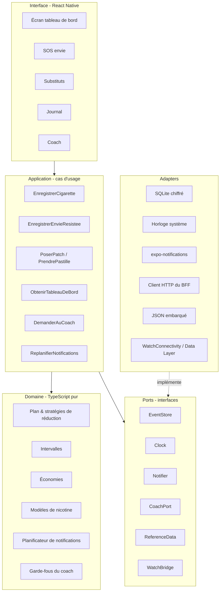
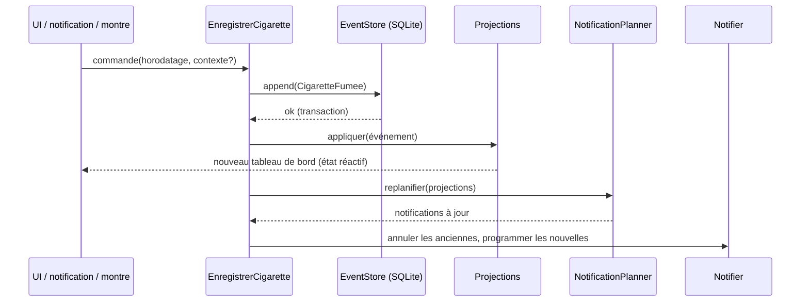
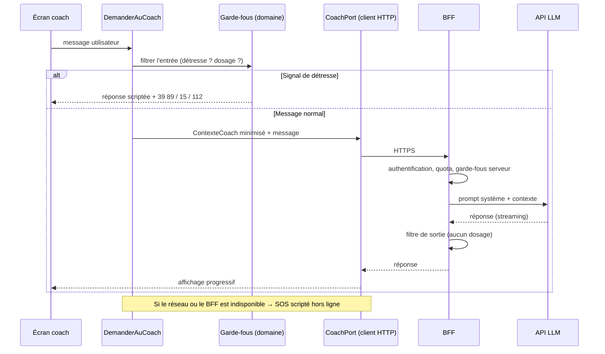
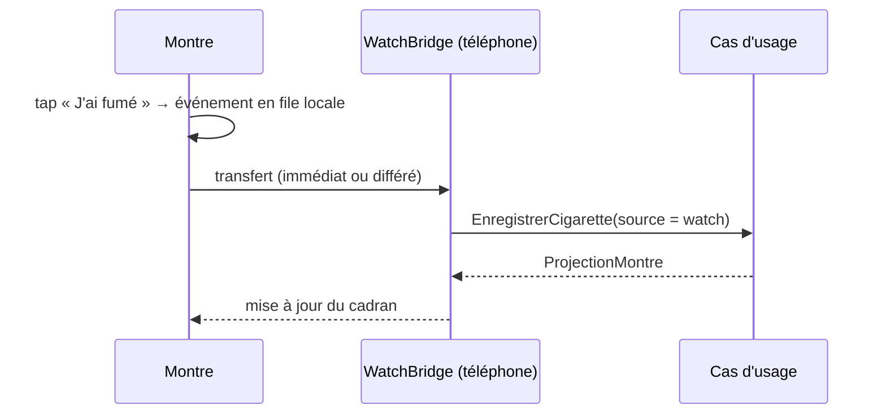
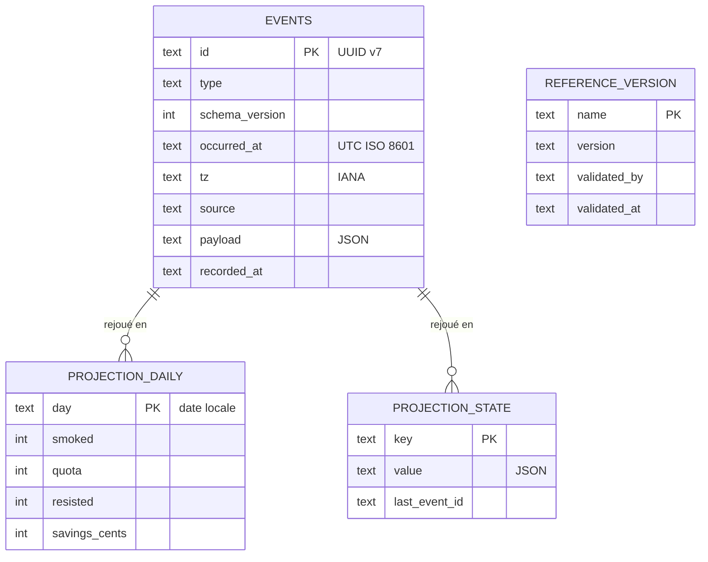

# 03 — Architecture applicative

> Statut : **v0.1 — brouillon de cadrage** · Dernière mise à jour : 2026-10-23

## 1. Principes

| Principe | Application dans Déclic |
|---|---|
| **Hexagonale (ports & adapters)** | Le domaine est du TypeScript pur, sans dépendance à React, à la base ou à l'horloge système |
| **Event sourcing local** | La source de vérité est un journal d'événements immuables, stocké sur le téléphone |
| **CQRS léger** | Écriture = ajout d'un événement ; lecture = projections précalculées |
| **Local-first** | Tout fonctionne hors ligne ; le réseau n'est requis que pour le coach IA (V2) |
| **Configuration par les données** | Les paramètres pharmacologiques et les contenus santé sont dans une table de référence versionnée |
| **Le LLM explique, le code calcule** | Aucun calcul métier n'est confié au modèle de langage |

Les décisions correspondantes sont tracées dans les [ADR](adr/).

## 2. Vue en couches



Règle de dépendance : **les flèches pointent vers le domaine**. Le domaine ne connaît que les interfaces des ports.

## 3. Modules

| Module | Responsabilité | Entrées | Sorties |
|---|---|---|---|
| `domain/events` | Types des événements et validation | — | `DomainEvent` |
| `domain/reduction` | Stratégies `ReductionStrategy` : −1/j, −1/2j, −1/semaine, palier | profil, date | quota du jour |
| `domain/intervals` | Intervalle cible, prochaine cigarette, moyennes réelles | quota, horaires, événements | fenêtre du jour |
| `domain/savings` | Économies par jour, cumul, projection, objectifs | événements, historique des prix | montants |
| `domain/substitutes` | Modèles `NicotineModel` (patch, pastille, gomme), limites de la notice | prises, table de référence | courbe estimée, alertes |
| `domain/notifications` | `NotificationPlanner` : quoi notifier et quand, plafond, heures calmes | projections, préférences | liste planifiée |
| `domain/coach` | Construction du résumé minimisé, garde-fous d'entrée et de sortie | projections | `CoachContext`, verdicts |
| `application/*` | Orchestration des cas d'usage | commandes de l'UI | événements, projections |
| `adapters/*` | Implémentations techniques des ports | — | — |

## 4. Événements du domaine

| Événement | Charge utile principale | Émis par |
|---|---|---|
| `ProfilCree` | n, prix, cigarettes par paquet, horaires, rythme | Onboarding |
| `PlanDemarre` | date de début, stratégie | Onboarding |
| `RythmeModifie` | nouvelle stratégie | Réglages |
| `PalierDemande` | date | Coach / utilisateur |
| `CigaretteFumee` | horodatage, contexte?, intensité? | App, notification, montre |
| `EnvieResistee` | horodatage, stratégie? | App, notification, montre |
| `SaisieAnnulee` | id de l'événement annulé | Journal |
| `PatchPose` / `PatchRetire` | dosage, durée de port, site | Substituts |
| `PastillePrise` / `GommePrise` | dosage, horodatage | Substituts, montre |
| `PrixModifie` | nouveau prix, date d'effet | Réglages |
| `ObjectifEpargneDefini` | libellé, montant | Économies |
| `ConsentementModifie` | finalité, accordé / retiré | Confidentialité |

Chaque événement porte : `id` (UUID v7, ordonnable), `type`, `version` du schéma, `occurredAt` (UTC), `tz` (fuseau IANA au moment de l'événement), `source` (`phone`, `notification`, `watch`), `payload`.

Un événement n'est **jamais modifié** : une correction s'exprime par un `SaisieAnnulee` suivi d'un nouvel événement.

## 5. Projections (côté lecture)

| Projection | Contenu | Recalcul |
|---|---|---|
| `TableauDeBordDuJour` | quota, restant, prochaine cigarette, intervalle moyen, économies du jour | à chaque événement |
| `HistoriqueQuotidien` | une ligne par jour : fumées, quota, économies | à la clôture du jour et à chaque événement du jour |
| `EtatSubstituts` | patch en cours, temps restant, prises du jour / maximum | à chaque événement de substitut |
| `StatistiquesHebdo` | contextes à risque, heures à risque, envies résistées | quotidien |
| `ProjectionMontre` | 4 champs prêts à afficher | à chaque changement du tableau de bord |
| `ContexteCoach` | résumé minimisé, sans horodatage précis ni texte libre identifiant | à la demande |

Les projections sont **jetables** : on peut toujours les reconstruire en rejouant le journal (après une migration ou un bug, par exemple).

## 6. Flux principaux

### 6.1 Enregistrer une cigarette



### 6.2 Demander au coach (V2)



### 6.3 Synchronisation avec la montre (V2)



La montre **ne calcule rien** : elle émet des événements et affiche une projection. L'`id` UUID généré sur la montre rend la réception **idempotente** (un doublon est ignoré).

## 7. Modèle de données local



Les montants sont stockés **en centimes (entiers)** pour éviter les erreurs d'arrondi.

## 8. Table de référence pharmacologique

Fichier [`app/config/pharma-reference.json`](../../app/config/pharma-reference.json), versionné et **validé par un professionnel** avant publication. Version actuelle (brouillon, aucune valeur pharmacologique renseignée volontairement) :

```json
{
  "version": "0.0.0-brouillon",
  "validePar": null,
  "valideLe": null,
  "oraux": [
    { "forme": "pastille", "maxParJour": null },
    { "forme": "gomme", "maxParJour": null }
  ]
}
```

Tant que `validePar` est vide, l'app **n'affiche ni maximum de prises ni courbe estimée** (RM-09 et F4.4 inactifs). Les paramètres des modèles de nicotine (F4.4, V2) seront ajoutés à ce fichier au moment de leur validation.

Les contenus santé suivent la même règle : [`app/config/health-milestones.json`](../../app/config/health-milestones.json) n'est pas notifié tant que `validePar` est vide.

## 9. Structure du dépôt (cible)

```
declic-quit-coach/
├── app/                      # application Expo (React Native)
│   ├── config/               # tables de référence versionnées (validées par un professionnel)
│   │   ├── pharma-reference.json
│   │   └── health-milestones.json
│   └── src/
│       ├── domain/           # pur, testé (objectif 100 %)
│       ├── application/      # cas d'usage
│       ├── ports/            # interfaces
│       ├── adapters/         # mémoire (actuel) ; sqlite, notifications, coach-http, watch-bridge (à venir)
│       └── ui/               # écrans
├── watch/                    # V2
│   ├── ios/                  # app watchOS (SwiftUI)
│   └── wearos/               # app Wear OS (Kotlin, Compose)
├── bff/                      # API du coach (V2, serverless)
└── docs/
    └── architecture/
        └── adr/
```

Les tables de configuration sont dans `app/` pour être embarquées par le bundler sans configuration particulière de Metro.
