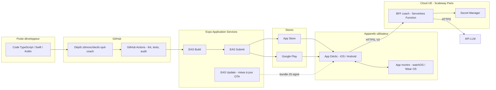

# 04 — Architecture technique

> Statut : **v0.1 — brouillon de cadrage** · Dernière mise à jour : 2026-10-23
>
> Les versions précises des bibliothèques seront figées au moment de l'initialisation du code (`package.json`, lockfile).

## 1. Vue de déploiement

## 2. Pile technique

| Couche | Choix | Justification | Alternative écartée |
|---|---|---|---|
| Framework mobile | **React Native + Expo** (TypeScript strict) | Une base iOS + Android, build cloud, mises à jour OTA, plugins natifs | Flutter (Dart, moins de réutilisation côté BFF) ; PWA (notifications limitées sur iOS) |
| Navigation | Expo Router (à ajouter avec le 2e écran ; le prototype actuel n’a qu’un écran) | Navigation par fichiers, liens profonds (depuis les notifications) | React Navigation seul |
| État réactif | Zustand | Léger, abonnements aux projections | Redux (trop lourd ici) |
| Stockage local | **SQLite** (`expo-sqlite`) avec chiffrement (SQLCipher) | Requêtes, transactions, journal d'événements | AsyncStorage (pas transactionnel) |
| Secrets locaux | `expo-secure-store` (Keychain iOS / Keystore Android) | Clé de chiffrement de la base, jeton du BFF | — |
| Notifications | `expo-notifications` (locales au MVP) | Notifications programmées et actionnables | — |
| Biométrie | `expo-local-authentication` | Verrouillage de l'app (F9.3) | — |
| Dates et fuseaux | `Temporal` (polyfill) ou `date-fns-tz` | Jours locaux, changement d'heure, voyage | `Date` natif seul (piégeux) |
| Tests du domaine | **Vitest** + tests par propriétés (`fast-check`) | Calculs santé : invariants vérifiés automatiquement | — |
| Tests E2E | Maestro | Parcours sur simulateur, simple à écrire | Detox (plus lourd) |
| Montre iOS | Swift / SwiftUI + WatchConnectivity, cible ajoutée via plugin de configuration Expo | Seule voie pour watchOS | — |
| Montre Android | Kotlin / Jetpack Compose for Wear OS + Wearable Data Layer | Seule voie pour Wear OS | — |
| BFF (V2) | Node.js / TypeScript sur **Scaleway Serverless Functions** (région Paris) | Hébergement UE, paiement à l'usage, partage des types avec l'app | Cloudflare Workers (réseau mondial, moins de maîtrise de la localisation) |
| LLM (V2) | **Claude Haiku 5.5** par défaut ; modèle plus puissant seulement si la qualité l'exige | Coût très faible par conversation, latence basse | Modèle haut de gamme partout (×20 environ sur le coût) |
| Suivi des erreurs | Sentry (SDK React Native), **sans données de santé** | Crashs et performances | — |
| CI/CD | GitHub Actions + EAS Build / Submit / Update | Intégré à Expo | Fastlane seul |

## 3. Sécurité

### 3.1 Sur le téléphone

| Mesure | Détail |
|---|---|
| Chiffrement au repos | Base SQLite chiffrée ; clé aléatoire de 256 bits générée au premier lancement, stockée dans le Keychain / Keystore |
| Verrouillage | Biométrie ou code optionnel à l'ouverture |
| Masquage | Contenu masqué dans le sélecteur d'apps (capture de l'écran récent) |
| Sauvegarde OS | Base incluse dans la sauvegarde chiffrée iCloud / Google, ou exclue selon le choix de l'utilisateur (ADR à trancher) |
| Notifications | Option « contenu discret » : « Déclic : un nouveau message » sur l'écran verrouillé |
| Journaux | Aucune donnée de santé dans les logs ni dans Sentry |

### 3.2 Entre le téléphone et le BFF (V2)

| Mesure | Détail |
|---|---|
| Transport | HTTPS, TLS 1.2 minimum (1.3 de préférence) |
| Authentification | Jeton d'installation anonyme (aucun compte, aucun e-mail au MVP) |
| Intégrité de l'app | App Attest (iOS) / Play Integrity (Android) pour limiter les abus sur le BFF |
| Limite de débit | Par installation et global (protection du budget LLM) |
| Minimisation | Le BFF reçoit un `ContexteCoach` agrégé ; ni horodatage précis, ni nom, ni texte libre de l'onboarding |
| Secrets | Clé de l'API LLM uniquement dans le Secret Manager, **jamais dans l'app** |

### 3.3 Chaîne d'approvisionnement

- Dependabot ou Renovate sur l'app et le BFF.
- `npm audit` et analyse SAST (CodeQL) dans la CI.
- Branches protégées, revue obligatoire, commits signés recommandés.
- SBOM généré à chaque version (CycloneDX).

## 4. Environnements

| Environnement | Usage | BFF | Données |
|---|---|---|---|
| `dev` | Développement local, simulateurs | BFF local ou bouchon | Fictives |
| `preview` | Tests internes (TestFlight, test interne Google Play) | BFF `preview` | Fictives ou testeurs volontaires |
| `production` | Stores | BFF `prod` | Réelles, sur le téléphone uniquement |

Les canaux EAS Update sont alignés sur ces environnements.

### 4.1 Mises à jour OTA (EAS Update)

- Le build `preview` (APK) écoute le canal `preview`, le build `production` le canal `production`.
- `runtimeVersion` suit la politique **fingerprint** : une mise à jour n'est livrée qu'aux builds dont le code natif est identique. Ajouter un module natif (ex. chiffrement, biométrie) change l'empreinte et impose un nouveau build ; le code JS et les écrans passent par OTA.
- L'empreinte dépend du poste (fins de ligne, OS) : builds et mises à jour sont lancés depuis le **même poste Windows**. Une empreinte calculée sous Linux diffère, sans conséquence tant qu'on ne publie pas depuis Linux.
- Une mise à jour est téléchargée à une ouverture et appliquée à la suivante (ou via le bandeau « Redémarrer »).
- Au lancement, l'app vérifie la présence d'une mise à jour (`checkAutomatically: ON_LOAD`, sans bloquer l'ouverture : `fallbackToCacheTimeout: 0`). Une fois téléchargée, un bandeau « Nouvelle version prête · Redémarrer » s'affiche ; sinon elle s'applique au lancement suivant.
- En cas de mise à jour défectueuse, `expo-updates` revient à la version embarquée ; on peut aussi republier la version précédente (`eas update:rollback`).
- Les données (SQLite) ne sont jamais touchées par une mise à jour OTA.
- Publication : `eas update --channel preview --message "…" --environment preview`.

## 5. Qualité et tests

| Niveau | Cible | Outil |
|---|---|---|
| Domaine | 100 % des lignes et des branches ; invariants par propriétés (le quota ne monte jamais sans palier, les économies ne sont jamais négatives, la somme des économies quotidiennes est égale au cumul) | Vitest + fast-check |
| Application | Cas d'usage avec des ports en mémoire (`FakeClock`, `InMemoryEventStore`) | Vitest |
| Adapters | SQLite et notifications en intégration | Jest + simulateur |
| E2E | Onboarding, « J'ai fumé », SOS, patch | Maestro |
| Coach (V2) | Jeu d'évaluation des garde-fous : questions de dosage, messages de détresse, tentatives de contournement | Script d'évaluation dans la CI du BFF |

## 6. Observabilité

| Signal | Source | Contenu autorisé |
|---|---|---|
| Crashs, erreurs | Sentry | Trace technique, version, modèle d'appareil |
| Performances | Sentry | Démarrage, temps d'écran |
| Usage produit (opt-in) | Compteurs agrégés et anonymes | Écran ouvert, fonction utilisée — jamais une valeur de santé |
| BFF | Logs Scaleway | Statut, latence, tokens consommés ; **pas le contenu des messages** |
| Budget LLM | Tableau de bord du fournisseur + alerte | Coût journalier, seuil d'alerte |
