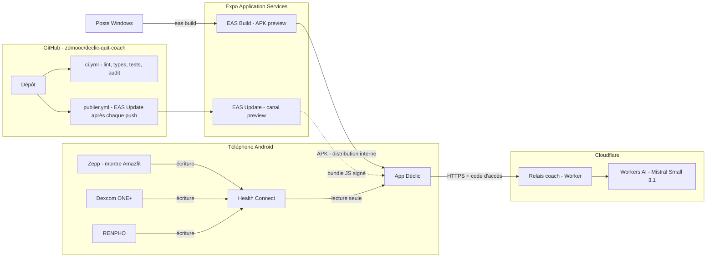

# 04 — Architecture technique

> Statut : **v0.2 — aligné sur le code** · Dernière mise à jour : 2026-10-28
>
> Versions figées dans `app/package.json` et son lockfile (Expo SDK 58, React Native 0.88, TypeScript strict). La colonne **État** distingue ce qui est en place de ce qui reste prévu.

## 1. Vue de déploiement

Pas de publication sur les stores pour l'instant : l'APK est installé directement (Auto Blocker Samsung désactivé le temps de l'installation).

## 2. Pile technique

| Couche | Choix | État | Remarque |
|---|---|---|---|
| Framework mobile | **React Native + Expo** (TypeScript strict) | ✅ | Expo SDK 58 |
| Navigation | Écrans en **modales** ouvertes depuis `App.tsx` et la barre d'onglets | ✅ | Expo Router reporté (liens profonds non nécessaires) |
| État de l'interface | Hook `useApplication` (rafraîchi toutes les 30 s et au retour au premier plan) | ✅ | Pas de Zustand : les projections sont recalculées |
| Stockage local | **SQLite** (`expo-sqlite`), table `events` en ajout seul | ✅ | **Non chiffré** : SQLCipher prévu (lot sécurité) |
| Secrets locaux | `expo-secure-store` | ⏳ prévu | Clé de la base ; aujourd'hui le code du coach est dans `reglages_locaux` |
| Notifications | `expo-notifications`, locales, actionnables | ✅ | Chargées seulement si les modules natifs sont présents |
| Biométrie | `expo-local-authentication` | ⏳ prévu | Verrouillage (F9.3) |
| Dates et fuseaux | Module maison `domain/time` sur `Intl` (jours locaux, changement d'heure) | ✅ | Testé, y compris passage à l'heure d'hiver |
| Santé du téléphone | `react-native-health-connect` + `expo-build-properties` (minSdk 26) | ✅ | Lecture seule (ADR-0011) |
| Tests | **Vitest** + `fast-check` (propriétés) | ✅ | 140 tests domaine et application |
| Tests E2E | Maestro | ⏳ prévu | Aucun test d'écran aujourd'hui |
| Apps montre natives | watchOS / Wear OS (ADR-0006) | ⏳ non commencé | Zepp OS serait la cible pour la montre Amazfit |
| Relais du coach | **Cloudflare Worker** + Workers AI (ADR-0009) | ✅ | Gratuit (10 000 neurones / jour) ; remplace le BFF Scaleway de l'ADR-0005 |
| LLM | **Mistral Small 3.1** (open source) via Workers AI | ✅ | Gratuit ; garde-fous côté app et relais |
| Suivi des erreurs | Sentry | ⏳ non branché | — |
| CI/CD | GitHub Actions (`ci.yml`, `publier.yml`) + EAS Build / Update | ✅ | Publication sans PC (secret `EXPO_TOKEN`) |

## 3. Sécurité

### 3.1 Sur le téléphone

| Mesure | Détail | État |
|---|---|---|
| Chiffrement au repos | Base SQLite chiffrée ; clé aléatoire de 256 bits dans le Keystore | ⏳ prévu (lot sécurité, reporté à la demande de l'utilisateur) |
| Verrouillage | Biométrie ou code optionnel à l'ouverture | ⏳ prévu |
| Masquage | Contenu masqué dans le sélecteur d'apps | ⏳ prévu |
| Sauvegarde | Fichier JSON choisi par l'utilisateur (Drive, Téléchargements) ; restauration vérifiée avant effacement | ✅ (fichier **non chiffré**) |
| Données Health Connect | Lues à la demande, jamais stockées ni sauvegardées, jamais envoyées au coach | ✅ |
| Bilans biologiques | Dans le journal local et la sauvegarde ; jamais envoyés au coach | ✅ |
| Notifications | Option « contenu discret » | ⏳ prévu |
| Journaux | Aucune donnée de santé dans les logs | ✅ |

### 3.2 Entre le téléphone et le relais du coach

| Mesure | Détail |
|---|---|
| Transport | HTTPS, TLS 1.2 minimum (1.3 de préférence) |
| Authentification | **Code d'accès partagé** (`APP_TOKEN`, secret Cloudflare) saisi dans Réglages ; jeton par installation prévu |
| Intégrité de l'app | Play Integrity : prévu si l'app est diffusée |
| Limite de débit | Par installation et global (protection du budget LLM) |
| Minimisation | Le BFF reçoit un `ContexteCoach` agrégé ; ni horodatage précis, ni nom, ni texte libre de l'onboarding |
| Secrets | Aucun secret de LLM dans l'app : Workers AI est appelé par le relais ; le code d'accès est un secret Cloudflare |

### 3.3 Chaîne d'approvisionnement

- `npm audit` (production) dans la CI : ✅ (non bloquant ; alertes dans les outils de build Expo, pas dans l'app).
- Dependabot / Renovate, CodeQL : ⏳ prévus.
- Branches protégées, revue obligatoire, commits signés recommandés.
- SBOM généré à chaque version (CycloneDX).

## 4. Environnements

| Environnement | Usage | BFF | Données |
|---|---|---|---|
| `dev` | Développement local, simulateurs | BFF local ou bouchon | Fictives |
| `preview` | Tests internes (TestFlight, test interne Google Play) | BFF `preview` | Fictives ou testeurs volontaires |
| `production` | Stores | BFF `prod` | Réelles, sur le téléphone uniquement |

Les canaux EAS Update sont alignés sur ces environnements.

### 4.1 Mises à jour OTA (EAS Update)

- Le build `preview` (APK) écoute le canal `preview`, le build `production` le canal `production`.
- `runtimeVersion` suit la politique **fingerprint** : une mise à jour n'est livrée qu'aux builds dont le code natif est identique. Ajouter un module natif (ex. chiffrement, biométrie) change l'empreinte et impose un nouveau build ; le code JS et les écrans passent par OTA.
- L'empreinte dépend du poste (fins de ligne, OS). Le build se fait sur le poste Windows ; la **publication automatique** (`publier.yml`, Linux) ne recalcule pas l'empreinte : elle lit la version d'exécution du **dernier APK construit** (`eas build:list`, champ `runtime.version`) et publie pour celle-ci.
- Une mise à jour est téléchargée à une ouverture et appliquée à la suivante (ou via le bandeau « Redémarrer »).
- Au lancement, l'app vérifie la présence d'une mise à jour (`checkAutomatically: ON_LOAD`, sans bloquer l'ouverture : `fallbackToCacheTimeout: 0`). Une fois téléchargée, un bandeau « Nouvelle version prête · Redémarrer » s'affiche ; sinon elle s'applique au lancement suivant.
- En cas de mise à jour défectueuse, `expo-updates` revient à la version embarquée ; on peut aussi republier la version précédente (`eas update:rollback`).
- Les données (SQLite) ne sont jamais touchées par une mise à jour OTA.
- Publication : automatique à chaque push sur `main` qui touche l'app (si lint, types et tests passent), ou manuelle : `eas update --channel preview --environment preview --platform android --message "…"`.

## 5. Qualité et tests

| Niveau | Cible | Outil |
|---|---|---|
| Domaine | ≈ 98 % des lignes aujourd'hui (objectif 100 %) ; invariants par propriétés (le quota ne monte jamais sans palier, les économies ne sont jamais négatives…) | Vitest + fast-check |
| Application | Cas d'usage avec des ports en mémoire (`FakeClock`, `InMemoryEventStore`) | Vitest |
| Adapters | SQLite (test unitaire avec base simulée) ; notifications et Health Connect non testés automatiquement | Vitest |
| E2E / écrans | Onboarding, « J'ai fumé », SOS, patch — **aucun aujourd'hui** | Maestro (prévu) |
| Coach | Garde-fous (dosage, détresse) testés côté app et côté relais | Vitest (CI `coach-relay`) |

## 6. Observabilité

| Signal | Source | Contenu autorisé |
|---|---|---|
| Crashs, erreurs | Sentry (⏳ non branché) ; aujourd'hui : message « Non enregistré » à l'écran pour toute action en échec | Trace technique, version, modèle d'appareil |
| Performances | Sentry | Démarrage, temps d'écran |
| Usage produit (opt-in) | Compteurs agrégés et anonymes | Écran ouvert, fonction utilisée — jamais une valeur de santé |
| Relais du coach | Logs Cloudflare | Statut, latence ; **pas le contenu des messages** |
| Budget LLM | Tableau de bord du fournisseur + alerte | Coût journalier, seuil d'alerte |
