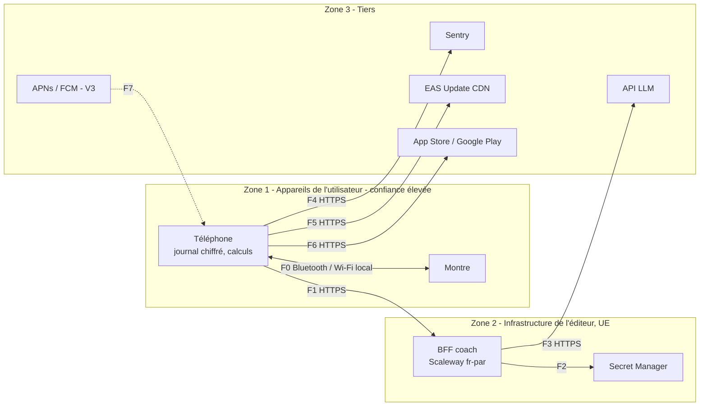

# 05 — Architecture réseau et flux

> Statut : **v0.1 — brouillon de cadrage** · Dernière mise à jour : 2026-10-23

## 1. Principe

Au MVP, **l'app n'a besoin d'aucun réseau** pour fonctionner : le journal, les calculs et les notifications sont locaux. Le réseau sert à :

1. installer et mettre à jour l'app (stores, EAS Update) ;
2. remonter les crashs (Sentry, sans données de santé) ;
3. à partir de la V2, appeler le coach IA via le BFF.

## 2. Zones de confiance



## 3. Matrice des flux

| ID | Source → Destination | Protocole | Données | Sensibilité | Phase |
|---|---|---|---|---|---|
| F0 | Téléphone ↔ Montre | WatchConnectivity (iOS) / Wearable Data Layer (Android), chiffré par l'OS | Événements (`CigaretteFumee`…), `ProjectionMontre` | Santé — reste sur les appareils de l'utilisateur | V2 |
| F1 | Téléphone → BFF | HTTPS (TLS 1.3), JSON, réponse en streaming (SSE) | `ContexteCoach` minimisé + message | Santé pseudonymisée et agrégée | V2 |
| F2 | BFF → Secret Manager | API interne Scaleway | Clé de l'API LLM | Secret | V2 |
| F3 | BFF → API LLM | HTTPS | Prompt système + contexte minimisé | Santé pseudonymisée — **transfert hors UE possible** (voir § 5) | V2 |
| F4 | Téléphone → Sentry | HTTPS | Traces techniques | Faible (aucune donnée de santé) | MVP |
| F5 | Téléphone → EAS Update | HTTPS | Téléchargement du bundle JS signé | Faible | MVP |
| F6 | Téléphone → Stores | HTTPS | Installation, mises à jour | Faible | MVP |
| F7 | APNs / FCM → Téléphone | Push OS | Notifications serveur (défis collectifs, buddy) | Faible, contenu générique | V3 |

## 4. Règles réseau

| Règle | Détail |
|---|---|
| R-01 | Tout trafic sortant en HTTPS ; aucun appel en clair |
| R-02 | Aucune donnée personnelle ni de santé dans les URL ou les en-têtes (seulement dans le corps chiffré) |
| R-03 | Le BFF n'expose qu'un seul point d'entrée : `POST /v1/coach/messages` (et `GET /v1/health` pour la supervision) |
| R-04 | Délais d'expiration : 10 s pour le premier octet, 30 s au total ; au-delà, retour au SOS scripté |
| R-05 | Nouvelles tentatives côté app : uniquement sur les erreurs réseau et 5xx, au maximum 2, avec un délai exponentiel et aléatoire |
| R-06 | Limite de débit sur le BFF : par jeton d'installation et globale (protection du budget) |
| R-07 | CORS fermé (pas de client navigateur) |
| R-08 | Épinglage de certificat : non au MVP (risque de blocage lors d'une rotation) ; à réévaluer après l'AIPD |
| R-09 | Les en-têtes de réponse ne divulguent ni version de serveur ni pile technique |

## 5. Localisation des données

| Donnée | Où elle se trouve |
|---|---|
| Journal d'événements, profil, motivations | **Téléphone uniquement** (et sauvegarde OS si l'utilisateur l'active) |
| `ContexteCoach` | En transit vers le BFF (Paris), **non conservé** après la réponse |
| Prompt envoyé au LLM | Chez le fournisseur LLM selon son contrat ; à vérifier : région de traitement, durée de rétention, absence d'entraînement sur les données, accord de traitement (DPA) et mécanisme de transfert hors UE |
| Crashs | Sentry (choisir la région UE si disponible) |

> À faire avant la V2 : AIPD (analyse d'impact) incluant le flux F3, et choix contractuel du fournisseur LLM. Si la conformité du transfert hors UE n'est pas satisfaisante, alternatives : fournisseur LLM hébergé en UE, ou modèle open-weights hébergé sur un GPU en UE (coût fixe plus élevé, voir 07).

## 6. Contrat d'API du BFF (V2, ébauche)

```http
POST /v1/coach/messages
Authorization: Bearer <jeton d'installation>
X-App-Attest: <jeton d'intégrité>
Content-Type: application/json

{
  "context": {
    "phase": "reduction",
    "planDay": 9,
    "quotaToday": 11,
    "smokedToday": 6,
    "avgIntervalVsTarget": 0.82,
    "topTriggers": ["cafe", "stress"],
    "resistedLast7d": 5,
    "substitutes": { "patchActive": true, "lozengesToday": 3, "lozengesMaxReached": false },
    "savingsTotalCents": 3575
  },
  "message": "j'ai trop envie là",
  "locale": "fr-FR"
}
```

Réponse : flux SSE de fragments de texte, puis un événement final `{ "done": true, "safety": "ok" | "redirected" }`.
