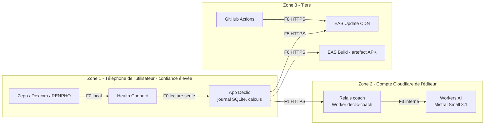

# 05 — Architecture réseau et flux

> Statut : **v0.2 — aligné sur le code** · Dernière mise à jour : 2026-10-28 (relais Cloudflare, Health Connect, publication GitHub)

## 1. Principe

Au MVP, **l'app n'a besoin d'aucun réseau** pour fonctionner : le journal, les calculs et les notifications sont locaux. Le réseau sert à :

1. installer et mettre à jour l'app (APK EAS Build, mises à jour EAS Update) ;
2. appeler le coach IA via le relais Cloudflare (facultatif, avec consentement) ;
3. plus tard : remonter les crashs (Sentry, sans données de santé).

Health Connect est un service **local** au téléphone : sa lecture ne passe par aucun réseau.

## 2. Zones de confiance



## 3. Matrice des flux

| ID | Source → Destination | Protocole | Données | Sensibilité | Phase |
|---|---|---|---|---|---|
| F0 | Applications santé → Health Connect → Déclic | API Android locale (aucun réseau) | Sommeil, cœur, HRV, pas, SpO2, glycémie, tension, poids | Santé — **reste sur le téléphone**, non stockée par Déclic | ✅ |
| F1 | Téléphone → relais | HTTPS, JSON, `Authorization: Bearer <code d'accès>` | Résumé minimisé (`resumeCoach`) + derniers tours de conversation | Santé pseudonymisée et agrégée ; **jamais** les bilans ni les mesures Health Connect | ✅ |
| F3 | Relais → Workers AI | Interne Cloudflare | Prompt système + résumé + tours | Santé pseudonymisée ; modèle open source exécuté chez Cloudflare (pas d'entraînement sur les données selon Cloudflare ; région de traitement à vérifier pour une diffusion publique) | ✅ |
| F4 | Téléphone → Sentry | HTTPS | Traces techniques | Faible | ⏳ |
| F5 | Téléphone → EAS Update | HTTPS | Bundle JS signé | Faible | ✅ |
| F6 | Téléphone → EAS (artefact) | HTTPS | Téléchargement de l'APK | Faible | ✅ |
| F7 | APNs / FCM → Téléphone | Push OS | Notifications serveur | Faible | V3 |
| F8 | GitHub Actions → EAS | HTTPS, `EXPO_TOKEN` | Publication d'une mise à jour | Faible (aucune donnée utilisateur) | ✅ |

## 4. Règles réseau

| Règle | Détail |
|---|---|
| R-01 | Tout trafic sortant en HTTPS ; aucun appel en clair |
| R-02 | Aucune donnée personnelle ni de santé dans les URL ou les en-têtes (seulement dans le corps chiffré) |
| R-03 | Le relais n'expose qu'un point d'entrée : `POST /coach` |
| R-04 | Délais d'expiration : 10 s pour le premier octet, 30 s au total ; au-delà, retour au SOS scripté |
| R-05 | Nouvelles tentatives côté app : uniquement sur les erreurs réseau et 5xx, au maximum 2, avec un délai exponentiel et aléatoire |
| R-06 | Limite de débit : quota gratuit Workers AI (10 000 neurones / jour) ; dépassement → 429 et retour au SOS scripté |
| R-07 | CORS fermé (pas de client navigateur) |
| R-08 | Épinglage de certificat : non au MVP (risque de blocage lors d'une rotation) ; à réévaluer après l'AIPD |
| R-09 | Les en-têtes de réponse ne divulguent ni version de serveur ni pile technique |

## 5. Localisation des données

| Donnée | Où elle se trouve |
|---|---|
| Journal d'événements, profil, motivations | **Téléphone uniquement** (et sauvegarde OS si l'utilisateur l'active) |
| Résumé du coach | En transit vers le relais Cloudflare, **non conservé** après la réponse |
| Mesures Health Connect | Dans Health Connect (téléphone) ; Déclic les lit à la demande sans les stocker |
| Bilans biologiques | Journal du téléphone et fichier de sauvegarde choisi par l'utilisateur |
| Prompt envoyé au LLM | Workers AI (Cloudflare) ; à vérifier avant une diffusion publique : région de traitement, rétention, DPA, transfert hors UE |
| Crashs | Sentry (choisir la région UE si disponible) |

> À faire avant une diffusion publique : AIPD (analyse d'impact) incluant les flux F1 et F3. Si la conformité du transfert hors UE n'est pas satisfaisante, alternatives : fournisseur LLM hébergé en UE, ou modèle open-weights hébergé sur un GPU en UE (coût fixe plus élevé, voir 07).

## 6. Contrat d'API du relais

```http
POST /coach
Authorization: Bearer <code d'accès>
Content-Type: application/json

{
  "mode": "sos" | "soir" | "fauxpas",
  "resume": { "phase": "reduction", "quotaDuJour": 9, "...": "valeurs agrégées, tronquées à 40 caractères" },
  "tours": [{ "role": "user", "texte": "j'ai trop envie là" }]
}
```

Réponse : `{ "texte": "…", "garde": false }`, ou `{ "texte": "<réponse fixe>", "garde": true }` quand un garde-fou (dosage, symptômes, détresse) répond sans appeler le modèle. Codes : 401 (code d'accès), 429 (quota gratuit épuisé).
