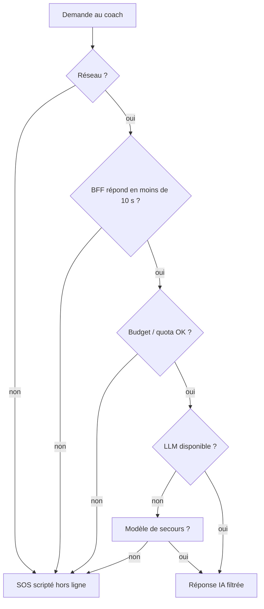

# 06 — Résilience et continuité

> Statut : **v0.1 — brouillon de cadrage** · Dernière mise à jour : 2026-10-23

## 1. Philosophie

La résilience de Déclic repose d'abord sur le **local-first** : la fonction vitale (« j'ai envie, aide-moi ») ne doit **jamais** dépendre du réseau ni d'un serveur. Les dépendances distantes (coach IA, crashs, mises à jour) sont **dégradables**.

| Niveau de service | Fonctions | Dépendance |
|---|---|---|
| **Vital** | Enregistrer une cigarette ou une envie, SOS scripté, tableau de bord, rappels de substituts | Téléphone seul |
| **Important** | Notifications programmées, montre | Téléphone + OS (+ montre) |
| **Confort** | Coach IA conversationnel, bilan du soir IA | Réseau + BFF + LLM |

## 2. Objectifs

| Indicateur | Cible | Commentaire |
|---|---|---|
| Disponibilité des fonctions vitales | 100 % hors panne de l'appareil | Aucune dépendance réseau |
| Disponibilité du coach IA | 99,5 % mensuel | Repli automatique vers le SOS scripté |
| **RPO** (perte de données maximale) sur le journal | 0 en fonctionnement normal (écriture transactionnelle) ; dernière sauvegarde OS ou dernier export en cas de perte du téléphone | — |
| **RTO** (temps de reprise) après réinstallation | moins de 5 min (restauration de la sauvegarde ou import de l'export) | — |
| RTO du BFF | moins de 1 h (redéploiement depuis la CI) | Sans état, rien à restaurer |

## 3. Analyse des modes de défaillance

| # | Défaillance | Effet | Détection | Mesure |
|---|---|---|---|---|
| D1 | Pas de réseau | Coach IA indisponible | Délai dépassé / erreur | **SOS scripté hors ligne**, message « coach indisponible, je reste là en mode hors ligne » |
| D2 | BFF en panne ou lent | Idem D1 | Délai de 10 s pour le premier octet | Idem D1 + alerte de supervision |
| D3 | API LLM en panne / limite de débit | Idem D1 | Erreur 429 / 5xx du fournisseur | Nouvelle tentative côté BFF (1 fois), puis repli ; option : second modèle de secours |
| D4 | Budget LLM dépassé | Coach coupé | Compteur de coût côté BFF | Coupure progressive (quota par utilisateur réduit) puis mode scripté ; alerte |
| D5 | Crash pendant une écriture | Événement perdu ou base corrompue | — | Transactions SQLite, mode WAL, contrôle d'intégrité au démarrage |
| D6 | Corruption d'une projection | Tableau de bord faux | Somme de contrôle / numéro du dernier événement appliqué | **Reconstruction** en rejouant le journal |
| D7 | Bug de calcul livré | Quota ou économies faux | Tests par propriétés en CI ; signalement utilisateur | Correctif via EAS Update, puis reconstruction des projections ; les événements, eux, restent justes |
| D8 | Migration de schéma ratée | App inutilisable | Test de migration en CI sur une base de référence | Migrations versionnées, sauvegarde automatique de la base avant migration, retour arrière |
| D9 | Perte ou changement de téléphone | Historique perdu | — | Sauvegarde OS chiffrée et/ou export chiffré manuel (F9.1), import (F9.5) |
| D10 | Notifications locales non délivrées | Rappel manqué (patch) | Vérification à chaque ouverture | Replanification à chaque ouverture et à chaque événement ; **iOS limite à 64 notifications locales en attente** : le planificateur ne programme que les prochaines 24 à 48 h |
| D11 | Notifications coupées par l'utilisateur ou l'OS (économie d'énergie Android) | Plus de rappels | Statut des permissions lu à l'ouverture | Bandeau explicatif dans l'app, aucun rappel critique ne dépend uniquement d'une notification |
| D12 | Montre déconnectée | Événements en attente sur la montre | File d'attente non vide | Transfert différé ; **idempotence** grâce à l'UUID de l'événement |
| D13 | Changement d'heure / voyage | Jour mal découpé, intervalle faux | — | Événements en UTC + fuseau IANA ; jour local calculé avec le fuseau ; tests dédiés (passage heure d'été/hiver, vol Paris → Montréal) |
| D14 | Horloge du téléphone modifiée | Horodatages incohérents | Événement plus ancien que le précédent | Accepté mais signalé ; jamais de rejet silencieux |
| D15 | Mise à jour OTA défectueuse | App cassée | Crash au démarrage (Sentry) | Retour automatique au bundle précédent d'EAS Update ; déploiement progressif (10 % → 100 %) |
| D16 | Compromission de la clé LLM | Abus, facture | Anomalie de consommation | Rotation de la clé dans le Secret Manager, limite de dépenses chez le fournisseur |
| D17 | Abus du BFF (bots) | Coût, indisponibilité | Taux de requêtes anormal | App Attest / Play Integrity, limite de débit, blocage par jeton |

## 4. Mécanismes clés

### 4.1 Intégrité du journal

- Écriture d'un événement dans une **transaction** ; la projection est mise à jour dans la **même transaction**.
- Mode **WAL** de SQLite pour résister aux coupures.
- `PRAGMA integrity_check` au démarrage (rapide sur une petite base).
- Chaque projection mémorise l'`id` du dernier événement appliqué : en cas d'écart, reconstruction automatique.

### 4.2 Sauvegarde et restauration

| Mécanisme | Déclenchement | Contenu | Chiffrement |
|---|---|---|---|
| Sauvegarde de l'OS (iCloud / Google) | Automatique, si l'utilisateur l'autorise | Base SQLite | Chiffrement de l'OS + base chiffrée (la clé doit être restaurable : Keychain synchronisé sur iOS ; à tester sur Android) |
| Export manuel | Bouton dans les réglages | JSON du journal | Chiffré par une phrase de passe choisie par l'utilisateur |
| Sauvegarde avant migration | Automatique | Copie de la base | Identique à la base |

Point d'attention : si la clé de chiffrement n'est pas restaurée avec la base, la sauvegarde est illisible. Ce scénario doit être **testé sur les deux plateformes** avant la mise en production.

### 4.3 Dégradation du coach IA

### 4.4 Livraison

- Déploiement progressif des mises à jour OTA et des versions des stores.
- Canal `preview` testé par un petit groupe avant `production`.
- Retour arrière : republication du bundle précédent sur le canal EAS Update.
- Le BFF est **sans état** : redéploiement de la version précédente depuis la CI en quelques minutes.

## 5. Exercices

| Exercice | Fréquence |
|---|---|
| Restaurer une sauvegarde OS sur un téléphone neuf (iOS et Android) | Avant chaque version majeure |
| Importer un export chiffré | Avant chaque version majeure |
| Couper le BFF et vérifier le repli | Chaque version du BFF |
| Rejouer un journal de 10 000 événements (performance de reconstruction) | Chaque version du domaine |
| Changement d'heure et changement de fuseau | Dans la suite de tests automatiques |
